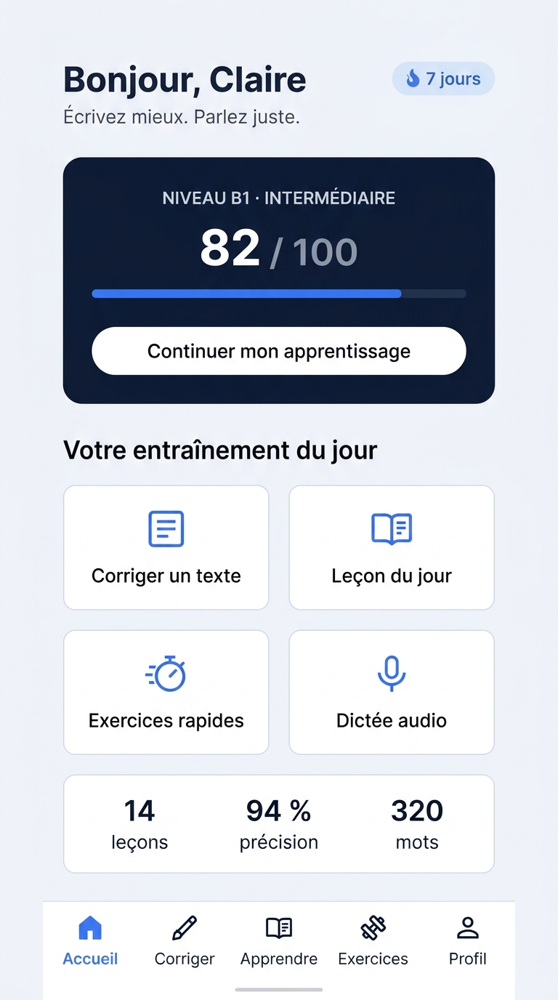
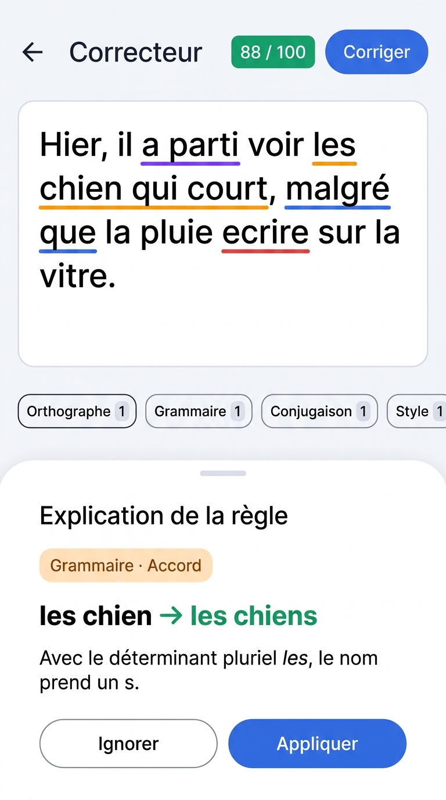
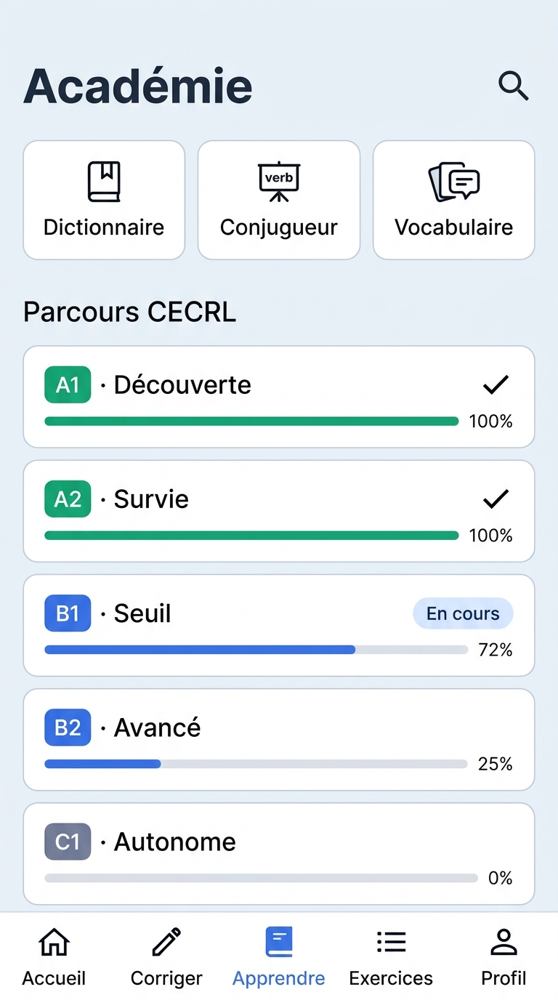

<div align="center">

# FRANÇAIS PRO

**Écrivez mieux. Parlez juste. Progressez chaque jour.**

*Application Android native 100 % hors ligne d'apprentissage, de correction linguistique et de maîtrise du français (CECRL A1 à C2).*

**Projet réalisé de bout en bout par Temgoua Mendel** — conception produit, Design System Material 3, moteur linguistique français embarqué, architecture Android, tests et packaging APK.

[-356AE6?style=flat-square&logo=android&logoColor=white)](https://developer.android.com/)
[](https://kotlinlang.org/)
[](https://developer.android.com/compose)
[](#principes-non-négociables)
[](SECURITY.md)
[](LICENSE)

[Aperçu](#-aperçu-de-linterface) · [Fonctionnalités](#-fonctionnalités-principales) · [Télécharger l'APK](#-téléchargement-et-installation-apk) · [Architecture](#-architecture--stack-technique) · [Documentation](#-documentation-du-projet) · [Auteur](#-à-propos--auteur)

</div>

---

## 🎯 Principes non négociables

**FRANÇAIS PRO** a été conçu dès l'origine comme un compagnon linguistique durable, privé et autonome :

- **100 % hors ligne** : toutes les fonctionnalités essentielles fonctionnent indéfiniment en mode avion (moteur linguistique embarqué, leçons, dictionnaire, conjugueur, exercices, dictées, statistiques).
- **Confidentialité absolue** : **aucune permission `INTERNET`** déclarée dans le manifeste, aucune télémétrie, aucun traceur, aucun compte requis.
- **Totalement gratuit** : aucune publicité, aucun abonnement, aucun achat intégré.
- **Stockage local maîtrisé** : base de données SQLite locale via Room (19 entités) avec export/import JSON portable via le sélecteur système Android (SAF).

---

## 📱 Aperçu de l'interface

<div align="center">

| Tableau de bord (Accueil) | Correcteur interactif & Explications | Académie CECRL (A1–C2) |
| :---: | :---: | :---: |
|  |  |  |
| *Progression, score global et entraînement quotidien* | *Surlignage sémantique 4 couleurs et fiche explicative* | *Niveaux CECRL, Dictionnaire, Conjugueur et Vocabulaire* |

</div>

> **Note sur les visuels** : les aperçus ci-dessus illustrent fidèlement le Design System implémenté (palette `#F4F6FA` / `#101B36` / `#356AE6`, composants Material 3 et hiérarchie typographique). Pour générer des captures directement depuis un smartphone ou un émulateur Android, consultez [`docs/screenshots/README.md`](docs/screenshots/README.md).

---

## ✨ Fonctionnalités principales

| Module | Capacités clés (100 % hors ligne) |
| :--- | :--- |
| **Correcteur linguistique hybride** | Détection orthographe, grammaire, accords, conjugaison, ponctuation, homophones et style ; surlignage interactif 4 couleurs (`#DC4545`, `#F59E0B`, `#7C3AED`, `#356AE6`), `BottomSheet` explicatif, application en un geste, comparaison Avant/Après et historique Room. |
| **Académie CECRL (A1 → C2)** | Leçons structurées en 8 sections (objectif, règle, exemples, pièges, mini-exercice intégré, récapitulatif) et suivi de complétion par niveau. |
| **10 formats d'exercices** | QCM, texte à trous, correction de phrase, accords, conjugaison, homophones, ponctuation, ordre des mots, transformation de phrase et vocabulaire, avec écran de bilan et révision ciblée. |
| **Dictées progressives** | Synthèse vocale locale (`TextToSpeech` `fr-FR`) avec repli visuel automatique si aucune voix française n'est installée, comparaison mot à mot et score de précision. |
| **Conjugueur & Recherche inverse** | Conjugaison multi-temps/modes (indicatif, subjonctif, conditionnel, impératif, participe), mise en évidence des verbes irréguliers et identification d'une forme conjuguée. |
| **Dictionnaire hors ligne** | Recherche instantanée avec définitions, nature grammaticale, synonymes, antonymes, exemples, favoris et historique de consultation. |
| **Vocabulaire intelligent (SM-2)** | Cartes mémoire à répétition espacée (algorithme SM-2), ajout de mots personnels et file de révision quotidienne. |
| **Atelier de rédaction** | 10 modèles guidés (e-mail professionnel, lettre de motivation, résumé, dissertation, rapport, etc.) reliés au correcteur intégré et sauvegardés en local. |
| **Expression orale** | Lecture à haute voix guidée, entraînement à l'articulation, virelangues, liaison et écoute modèle via TTS local. |
| **Statistiques & Progression** | 4 graphiques natifs Canvas alimentés par Room (évolution de la précision, maîtrise par compétence, activité hebdomadaire, erreurs fréquentes), série quotidienne et objectifs réalistes. |
| **Sauvegarde & Restauration** | Export et import complets en JSON via `ActivityResultContracts.CreateDocument` / `OpenDocument` (aucune permission stockage requise). |
| **Design System & Accessibilité** | Thèmes Clair / Sombre / Système, taille de police ajustable, mode dyslexie, cibles tactiles ≥ 48 dp et compatibilité `enableEdgeToEdge()`. |

---

## 🏗 Architecture & Stack Technique

Le projet suit les principes **MVVM**, **Clean Architecture** et séparation stricte entre logique linguistique, données et interface Compose.

```text
.
├── app/
│   └── src/
│       ├── main/
│       │   ├── java/com/example/
│       │   │   ├── core/            # Base Room (19 entités), DataStore, Design System, Navigation, DI, WorkManager
│       │   │   ├── data/            # Dépôts hors ligne, sauvegarde JSON SAF, seed linguistique
│       │   │   ├── domain/          # Modèles métier, contrats et cas d'usage
│       │   │   ├── features/        # 14 modules écrans (Accueil, Correcteur, Académie, Exercices, Profil...)
│       │   │   ├── learning/        # Algorithme SM-2, progression CECRL, générateur d'exercices
│       │   │   └── linguistics/     # Tokeniseur, lexique, morphologie, syntaxe, orthographe, conjugueur
│       │   └── res/                 # Ressources, icône adaptative, chaînes FR, thèmes
│       └── test/                    # 18 tests unitaires & UI Robolectric (JVM)
├── docs/                            # Documentation technique, Design System, Guide utilisateur, Captures
│   └── screenshots/                 # Aperçus officiels de l'interface
├── releases/                        # Convention et checklist de publication APK / AAB
├── .github/                         # CI/CD GitHub Actions (Tests, Lint, APK, Releases) & modèles PR/Issues
└── gradle/                          # Version Catalog (libs.versions.toml) & wrapper properties
```

### Stack principale

- **Langage** : Kotlin `2.4.21` · Coroutines & `StateFlow`
- **Interface** : Jetpack Compose (BOM `2024.09.00`) · Material Design 3 · Navigation Compose `2.8.9`
- **Persistance** : Room `2.7.0` (SQLite, 19 entités) · Jetpack DataStore Preferences `1.1.7`
- **Planification locale** : WorkManager `2.10.0` (rappel quotidien local optionnel)
- **Qualité & Tests** : JUnit 4 · Robolectric `4.16.1` · Compose UI Testing · Android Lint (`0` erreur)
- **Compatibilité Android** : `minSdk 24` (Android 7.0) · `targetSdk 36` · `compileSdk 36.1`

---

## 📦 Téléchargement et installation (APK)

Un fichier **APK prêt à installer** est disponible directement dans le dépôt :

- **Télécharger l'APK** : [`releases/FrancaisPro-v1.0.0.apk`](releases/FrancaisPro-v1.0.0.apk) *(Android 7.0+ / API 24–36, 100 % hors ligne)*
- **Empreinte de vérification** : [`releases/SHA256SUMS.txt`](releases/SHA256SUMS.txt)

### Installer sur un appareil Android

1. Téléchargez [`releases/FrancaisPro-v1.0.0.apk`](releases/FrancaisPro-v1.0.0.apk) (ou depuis l'onglet **[Releases](../../releases)** de GitHub).
2. *(Recommandé)* Vérifiez l'intégrité du fichier avec `releases/SHA256SUMS.txt` :
   ```bash
   (cd releases && sha256sum -c SHA256SUMS.txt)
   ```
3. Transférez l'APK sur votre appareil Android et ouvrez-le pour l'installer (autorisez *« Installer des applications inconnues »* pour votre navigateur ou gestionnaire de fichiers si demandé).
4. Profitez de l'application immédiatement, **même en mode avion**.

> Consultez [`docs/RELEASE_GUIDE.md`](docs/RELEASE_GUIDE.md) pour signer un APK/AAB de production ou automatiser de nouvelles releases GitHub via un tag Git.

---

## 🛠 Compiler et tester localement

### Prérequis

- **JDK 21** (recommandé pour AGP `9.1.1` et Gradle `9.3.1`)
- **Android SDK** (API 36) avec `ANDROID_SDK_ROOT` ou Android Studio configuré

### Commandes principales

```bash
# 1. Exécuter les 18 tests unitaires et Robolectric (JVM, sans émulateur)
gradle :app:testDebugUnitTest

# 2. Vérifier l'analyse statique Android Lint
gradle :app:lintDebug

# 3. Générer l'APK de test (sortie : app/build/outputs/apk/debug/app-debug.apk)
gradle :app:assembleDebug

# 4. Générer l'APK de production signé (nécessite KEYSTORE_PATH, STORE_PASSWORD, KEY_PASSWORD)
gradle :app:assembleRelease

# 5. Générer le bundle Android App Bundle (.aab) pour distribution
gradle :app:bundleRelease
```

---

## 📚 Documentation du projet

| Document | Contenu |
| :--- | :--- |
| [`docs/ARCHITECTURE.md`](docs/ARCHITECTURE.md) | Architecture logicielle, modules, moteur NLP hors ligne et schéma Room |
| [`docs/DESIGN_SYSTEM.md`](docs/DESIGN_SYSTEM.md) | Palette sémantique Clair/Sombre, typographie 9 niveaux, grille 4 dp et composants |
| [`docs/USER_GUIDE.md`](docs/USER_GUIDE.md) | Guide utilisateur complet (prise en main, correcteur, dictées, sauvegarde JSON) |
| [`docs/RELEASE_GUIDE.md`](docs/RELEASE_GUIDE.md) | Guide GitHub, CI/CD, signature APK/AAB, SHA-256 et captures d'écran |
| [`docs/GITHUB_DESCRIPTION.md`](docs/GITHUB_DESCRIPTION.md) | Présentation GitHub prête à copier (About, Topics et notes de Release v1.0.0) |
| [`docs/screenshots/README.md`](docs/screenshots/README.md) | Catalogue des captures d'écran et procédure de capture réelle via ADB |
| [`releases/README.md`](releases/README.md) | Nomenclature des APK/AAB et politique de publication GitHub Releases |
| [`CHANGELOG.md`](CHANGELOG.md) | Historique détaillé des versions |
| [`CONTRIBUTING.md`](CONTRIBUTING.md) | Règles de contribution, standards de code et checklist PR |
| [`SECURITY.md`](SECURITY.md) | Engagements de confidentialité hors ligne et signalement de vulnérabilités |
| [`LICENSE`](LICENSE) & [`THIRD_PARTY_LICENSES.md`](THIRD_PARTY_LICENSES.md) | Licence MIT et licences des bibliothèques open source utilisées |

---

## 👤 À propos & Auteur

**FRANÇAIS PRO** est un projet réalisé de bout en bout par **Temgoua Mendel**, de la conception produit jusqu'au packaging Android prêt à installer :

- **Conception produit & pédagogie** : parcours complet CECRL (A1 à C2), 10 formats d'exercices, dictées progressives, répétition espacée SM-2 et atelier de rédaction.
- **Moteur linguistique français hors ligne** : tokenisation, lexique, conjugueur + recherche inverse, détection orthographique, grammaticale, syntaxique, homophones et style sans aucune dépendance réseau.
- **Design System & UI Android** : identité visuelle Clair/Sombre, typographie structurée, 19 composants réutilisables, transitions `AnimatedContent` fluides (200 ms) et 24 écrans Jetpack Compose / Material 3.
- **Ingénierie, Qualité & Livraison** : architecture MVVM / Clean Architecture, persistance Room (19 entités) + DataStore + SAF JSON, 22 tests automatisés (JUnit / Robolectric), Android Lint sans erreur, APK prêt à télécharger et pipeline CI/CD GitHub Actions.

---

## 🤝 Contribuer & Licence

Les contributions respectant les principes **100 % hors ligne, gratuit et sans collecte de données** sont les bienvenues ! Consultez [`CONTRIBUTING.md`](CONTRIBUTING.md) avant d'ouvrir une Pull Request.

Distribué sous licence **MIT** — voir [`LICENSE`](LICENSE) pour plus d'informations.
