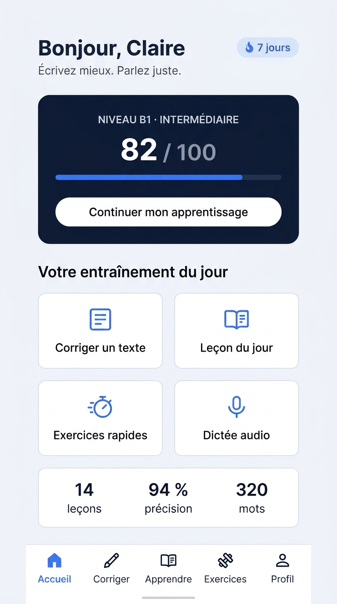
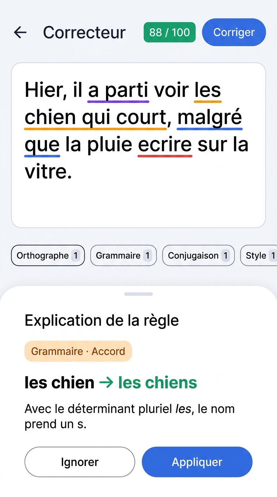
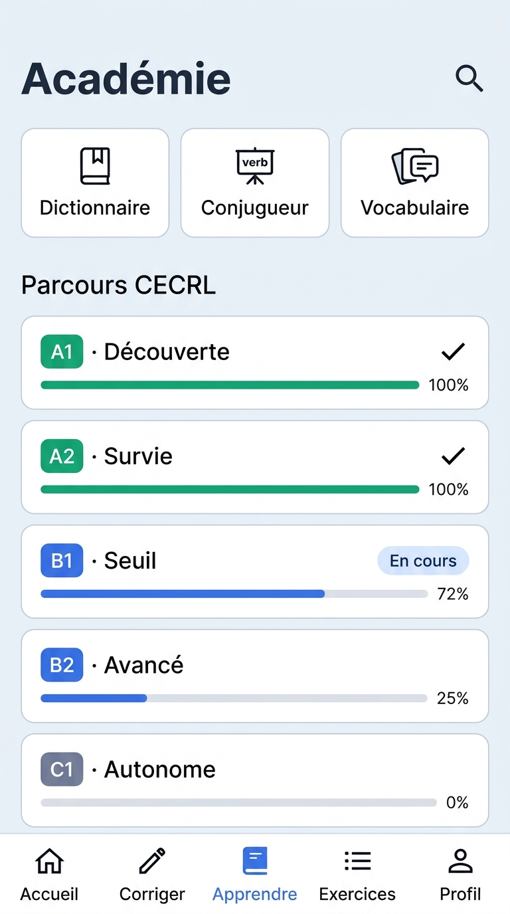

# Scénario de démonstration guidée (3 minutes) — FRANÇAIS PRO

*Projet réalisé de bout en bout par **Temgoua Mendel**.*

Ce scénario vous permet de tester rapidement l'ensemble des capacités de **FRANÇAIS PRO**, **même en mode avion**, directement sur votre appareil Android ou depuis l'écran intégré **Profil → Démo & Guide d'utilisation**.

---

## Préparation (10 secondes)

1. Installez l'application sur un appareil ou émulateur Android 7.0+ (API 24+).
2. *(Optionnel mais recommandé)* **Activez le mode avion** afin de vérifier l'autonomie 100 % hors ligne.
3. Lancez **FRANÇAIS PRO** : parcourez l'onboarding en 7 étapes (ou touchez **Ignorer** à tout moment pour accéder immédiatement au tableau de bord).

---

## Étape 1 — Tableau de bord (`Accueil`)



- Vérifiez l'affichage de votre niveau CECRL, de votre score global (`/ 100`), de votre série quotidienne et de votre objectif du jour.
- Touchez les 5 onglets inférieurs (**Accueil**, **Corriger**, **Apprendre**, **Exercices**, **Profil**) pour observer la transition fluide `AnimatedContent` (200 ms, fondu enchaîné + glissement directionnel).

---

## Étape 2 — Correcteur linguistique hors ligne (`Corriger`)



Collez ou saisissez la phrase de test suivante (ou chargez-la depuis **Profil → Démo & Guide**) :

```text
Bonjour, les rapport est pret malgré que nous avons oublier la piece jointe.
```

1. Touchez **Analyser** : le moteur hybride hors ligne calcule instantanément un score `/ 100` et surligne chaque faute par couleur :
   - **Rouge** : Orthographe (`pret` → `prêt`, `piece` → `pièce`)
   - **Orange** : Grammaire / Accords (`les rapport` → `les rapports`, `avons oublier` → `avons oublié`)
   - **Violet** : Syntaxe / Ponctuation (`malgré que` → `bien que`)
   - **Bleu** : Style et formulation
2. **Touchez un mot surligné** : la fiche explicative (`BottomSheet`) s'ouvre avec la règle grammaticale, un exemple correct et les boutons **Accepter** / **Ignorer**.
3. Testez **Tout corriger**, **Annuler / Rétablir** et la vue **Avant / Après**.

---

## Étape 3 — Académie CECRL & Outils de référence (`Apprendre`)



1. Ouvrez un niveau (**A1** à **C2**), puis ouvrez une leçon pour découvrir les **8 sections structurées** avec **mini-exercice intégré**.
2. Testez le **Conjugueur** en saisissant un verbe irrégulier (ex. `faire`, `aller`, `prendre`) ou en utilisant la **recherche inverse** (ex. `firent` → identifié comme *faire, passé simple, 3e pers. pl.*).
3. Consultez le **Dictionnaire hors ligne**, ajoutez un mot en favori et essayez une carte de **Vocabulaire SM-2**.

---

## Étape 4 — Exercices, Dictée & Statistiques (`Exercices` & `Profil`)

1. Dans **Exercices**, testez un exercice interactif puis ouvrez **Dictée** :
   - Si une voix française locale est présente, touchez **Écouter**.
   - Sinon, le **mode lecture visuelle rythmée** prend automatiquement le relais sans blocage.
2. Ouvrez **Profil → Statistiques détaillées** :
   - Touchez un jour sur le graphique **Progression hebdomadaire** pour afficher l'infobulle détaillée et l'état d'objectif.
   - Touchez une catégorie sur l'anneau **Répartition des erreurs** pour inspecter sa part exacte au centre du Donut.
3. Ouvrez **Profil → Sauvegarde & restauration** pour tester l'export JSON local via le sélecteur Android (SAF).

---

## Checklist de validation hors ligne

- [ ] Lancement et navigation 5 onglets fluides en **mode avion**
- [ ] Analyse et correction instantanée d'un texte sans connexion Internet
- [ ] Ouverture du `BottomSheet` pédagogique au clic sur une faute surlignée
- [ ] Consultation d'une leçon CECRL, du dictionnaire et du conjugueur inversé
- [ ] Inspection interactive des graphiques dans **Statistiques**
- [ ] Bascule **Thème Clair / Thème Sombre** dans **Paramètres**
- [ ] Export JSON fonctionnel sans aucune permission de stockage global
